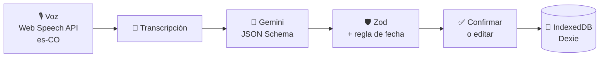

<div align="center">


# Simple Track

**Registra tus ingresos, gastos y transferencias hablando.**

Dices una frase, Gemini la convierte en movimientos, tú confirmas y queda guardado en tu teléfono.


</div>

---

## Tabla de contenido

- [Qué hace](#qué-hace)
- [Cómo funciona](#cómo-funciona)
- [Empezar](#empezar)
- [Scripts](#scripts)
- [Estructura del proyecto](#estructura-del-proyecto)
- [Modelo de datos](#modelo-de-datos)
- [Seguridad y privacidad](#seguridad-y-privacidad)
- [Deploy](#deploy)
- [Fuera de alcance](#fuera-de-alcance)

---

## Qué hace

|                           |                                                                                                                                                        |
| ------------------------- | ------------------------------------------------------------------------------------------------------------------------------------------------------ |
| 🎙️ **Entrada por voz**    | Toca el micrófono y di algo como _"pagué 20 mil de Netflix con Nequi y aboné un palo a la deuda desde Ahorros"_. Ves el texto en vivo mientras hablas. |
| 🤖 **Parsing con Gemini** | Convierte la frase en uno o varios movimientos. Entiende jerga colombiana de montos: _"20 mil"_, _"una luca"_ (1.000), _"un palo"_ (1.000.000).        |
| ✅ **Confirmación**       | Antes de guardar ves la lista de movimientos. Puedes guardar todo de una o editar cada uno. Los inválidos se marcan en rojo.                           |
| ✍️ **Formulario manual**  | Crear y editar movimientos sin voz. Al editar se conservan la fecha y la fecha de creación originales.                                                 |
| 📊 **Balance del mes**    | Total del mes con ingresos y gastos, selector de mes, lista agrupada por _Hoy / Ayer / Última semana / Resto del mes_.                                 |
| 🔎 **Filtros**            | Rango de fechas, búsqueda por descripción o categoría y orden por monto.                                                                               |
| 🏦 **Cuentas**            | Efectivo, Nequi, DaviPlata, Ahorros y Otros. Los saldos se actualizan solos con cada movimiento.                                                       |
| 📱 **Instalable**         | PWA en modo oscuro para Chrome Android. Sin backend, sin login, gratis.                                                                                |

> [!NOTE]
> La app **necesita internet**: el reconocimiento de voz de Chrome y Gemini funcionan en línea. No hay modo offline. Sin conexión verás "Sin conexión" con un botón "Reintentar", y el texto dictado no se pierde.

## Cómo funciona



1. **Voz.** `services/speech.ts` usa `webkitSpeechRecognition` en `es-CO`, con texto en vivo. Se reinicia sola si Android corta la grabación.
2. **Parsing.** `services/gemini.ts` llama directo a la Interactions API de Gemini (`gemini-3.5-flash-lite`) con un JSON Schema y `store: false`. No usa SDK.
3. **Validación.** La respuesta pasa por Zod: monto entero mayor que 0, categoría válida para el tipo, cuentas conocidas. Gemini devuelve `today` o `yesterday` y la app lo convierte a una fecha local.
4. **Confirmación.** Revisas los movimientos, los guardas todos en una transacción o editas cada uno.
5. **Persistencia.** Cada crear, editar o eliminar actualiza el movimiento y los saldos de las cuentas en **una sola transacción** de Dexie.

## Empezar

### Requisitos

- Node.js 24 (la versión con la que se desarrolla)
- Una API key de Gemini (gratis en [aistudio.google.com/apikey](https://aistudio.google.com/apikey))
- Chrome (en Android para la experiencia completa con voz)

### Instalación

```bash
npm install
```

```bash
npm run dev
```

Abre `http://localhost:5173`. La primera vez la app pide tu API key de Gemini y, si quieres, los saldos iniciales de cada cuenta.

> [!IMPORTANT]
> La API key **no va en el código ni en un `.env`**. Se pega en la app y se guarda solo en el IndexedDB de tu teléfono. Si Gemini la rechaza, la app abre un modal para pegar una nueva y reintenta con el mismo texto.

## Scripts

| Comando           | Qué hace                              |
| ----------------- | ------------------------------------- |
| `npm run dev`     | Servidor de desarrollo con Vite       |
| `npm run build`   | Revisa tipos (`tsc`) y genera `dist/` |
| `npm run preview` | Sirve `dist/` en local                |
| `npm test`        | Tests con Vitest                      |
| `npm run lint`    | ESLint                                |
| `npm run format`  | Prettier                              |

## Estructura del proyecto

```
src/
├── domain/        Lógica pura y con tests: tipos, categorías, cuentas,
│                  regla de fecha, balance, validación (Zod), formato, agrupación
├── db/            Dexie: esquema y repositorios (movimientos, cuentas, ajustes)
├── services/      speech.ts (voz) y gemini.ts (parsing)
├── hooks/         useMovements, useMonthlyBalance, useAccounts,
│                  useRecorder, useVoiceEntry, useApiKey
├── components/    Atomic design
│   ├── atoms/        Button, Amount, Input, Select, FilterChip
│   ├── molecules/    MovementRow, SearchInput, FormField
│   ├── organisms/    MicButton, MovementForm, MovementList, ConfirmModal,
│   │                 ApiKeyModal, AccountCard, AccountBalanceModal, BottomNav
│   └── templates/    MainLayout, ModalLayout
├── features/      Pantallas: setup, home, accounts
├── index.css      Tailwind v4 + tokens del design system en @theme
└── App.tsx        Navegación y pantalla de setup inicial
```

Las capas tienen reglas claras: `domain/` no conoce React ni Dexie, y los atoms y molecules no conocen Dexie ni Gemini.

## Modelo de datos

**Tipos de movimiento:** `income`, `expense` y `transfer`. Las transferencias mueven dinero entre dos cuentas, no tienen categoría y no cuentan en el balance del mes.

**Cuentas:** `efectivo`, `nequi`, `daviplata`, `ahorros` y `otros` (la cuenta por defecto).

<details>
<summary><b>Categorías</b></summary>

| Gastos                                                                                                                                   | Ingresos                               |
| ---------------------------------------------------------------------------------------------------------------------------------------- | -------------------------------------- |
| Comida y restaurantes, Mercado, Transporte, Vivienda, Servicios, Suscripciones, Salud, Entretenimiento, Compras, Mascotas, Deudas, Otros | Salario, Freelance, Apartamento, Otros |

Los ids están en inglés y los textos en español (`src/domain/categories.ts`).

</details>

<details>
<summary><b>Reglas de negocio</b></summary>

- Solo se registran movimientos de **hoy o ayer**, nunca fechas futuras.
- Los montos son enteros en pesos colombianos y se muestran con `Intl.NumberFormat('es-CO')`.
- Eliminar un movimiento lo deshabilita (soft delete) y revierte su efecto en los saldos.
- Editar revierte el efecto anterior y aplica el nuevo. `date` y `createdAt` nunca cambian; solo `updatedAt`.
- Cada movimiento guarda el texto original dictado (`rawText`).

</details>

## Seguridad y privacidad

- **Todo queda en tu teléfono.** No hay backend ni cuentas de usuario. Lo único que sale del dispositivo es el texto dictado, que va a Gemini con `store: false`.
- **CSP estricta** en [`vercel.json`](vercel.json): solo recursos del propio origen y conexiones a `generativelanguage.googleapis.com`. También envía `X-Content-Type-Options: nosniff` y `Referrer-Policy: no-referrer`.
- **Fuentes self-hosted** con `@fontsource`, sin Google Fonts ni otros CDN.
- No se usa `dangerouslySetInnerHTML`.
- Versiones exactas en `package.json` y `npm audit` limpio.

## Deploy

La app se despliega en **Vercel**, que aplica los headers de [`vercel.json`](vercel.json).

```bash
npm audit
```

```bash
npx vercel --prod
```

Después, en Chrome Android: abre la URL → menú ⋮ → **Instalar app**.

**Checklist de prueba en el teléfono:**

- [ ] Dictar una frase con varios movimientos y guardarlos
- [ ] Modo avión → aparece "Sin conexión" y "Reintentar" conserva el texto
- [ ] Editar un movimiento conserva su fecha
- [ ] Los saldos de las cuentas cuadran después de crear, editar y eliminar

## Fuera de alcance

Fuera de esta versión: WhatsApp, gráficas, tarjeta de crédito, multiusuario, sincronización en la nube, fechas que no sean hoy o ayer, modo offline y exportar a JSON.

---

<div align="center">
<sub>Hecho para uso personal · Dark mode only · es-CO</sub>
</div>
